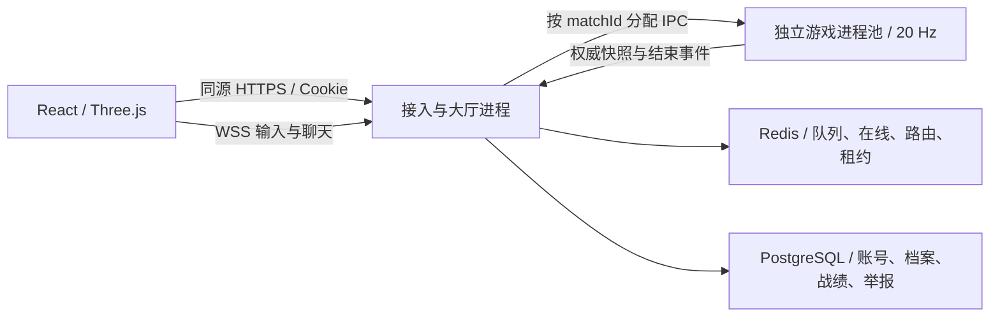

# 联机实现与后续开发边界

## 运行结构

当前每个 Redis 命名空间只允许一个接入与大厅进程。游戏进程数由 GAME_WORKERS 控制，每场仅由一个进程模拟；一个游戏进程可以承载多个房间。该实现不支持多个大厅共享同一队列，也不支持跨机器 IPC。扩展为多机网关时，需先将连接所有权与房间路由改成可跨机器的消息传输，并继续保留独占租约和结算 fencing，不能直接增加大厅副本。

| 代码入口 | 职责 |
| --- | --- |
| server.ts | 大厅、确认、房间与席位状态；游戏进程内的权威模拟；网关消息路由与结算协调 |
| backend/gamePool.ts | 子进程创建、房间分配、IPC 背压、存活检查与帧指标 |
| backend/services.ts / schema.sql | 账号、同源会话、PostgreSQL 事务、Redis 租约、聊天治理与持久结果查询 |
| backend/social.ts / teamQueue.ts | 好友关系、邀请权限与按整队分配 3v3 席位 |
| backend/eligibility.ts | 北京时间窗口、可开局剩余时长、运营方结果约束 |
| src/net/clientSocket.ts / account.ts | HTTP 账号与 WebSocket 生命周期；标题不自动入房 |
| src/game/LaserTagEngine.ts | 本地移动预测、权威校正、远端插值与显示 |
| src/shared/playerInput.ts / physics.ts | 服务端与客户端共享的移动和碰撞规则 |

## 会话与房间协议

HTTP 与 WebSocket 共用 HttpOnly Cookie。WebSocket 连接 /ws，并携带同源 Origin；不接受客户端声称的账号 ID。连接成功首先收到 session:state。新操控连接替换同账号旧连接，旧连接关闭码为 4409；会话撤销使用 4401。离线续局恢复席位、队伍和权威局内数据。

每个 JSON 数据包使用 `{type,payload}`。客户端应以服务器状态确认作为界面切换依据，不能在发出加入或开局请求后自行进入战场。

| 客户端消息 | payload |
| --- | --- |
| queue:join / queue:leave | `{}` |
| queue:confirm | `{readyId,accept}` |
| room:create | `{name?,mapId?,mode?,fillBots?,friendlyFire?,hazardIntensity?}` |
| room:preview | `{roomId}`，仅登录后预览 |
| room:join | `{roomId}`，邀请码即房间 ID |
| room:settings | 创建字段加 `version`，仅房主在等待阶段可修改 |
| room:team / room:ready | `{version,team}` / `{version,ready}` |
| room:start / room:cancel | `{version}`，由房主开始或取消倒计时 |
| room:leave | `{}` |
| party:create / party:leave | `{}` |
| social:invite / social:respond | `{kind,playerId}` / `{inviteId,accept}`，kind 为 room 或 party |
| chat:send | `{text}`，同房且在线才可发送 |
| player:input | `{matchId,seq,moveX,moveZ,yaw,pitch,ads,dash}` |
| player:fire | `{matchId,actionSeq,yaw?,pitch?,ads?}`，射线起点由服务端计算 |
| player:gadget / player:class_skill / player:mine / player:vent | `{matchId,actionSeq}` |
| player:buy_ammo | `{matchId,actionSeq,packId}` |
| player:ping | `{matchId,actionSeq,kind,yaw,pitch}`，kind 为 rally、danger、mine 或 support |

seq 与 actionSeq 分别递增。服务器丢弃已接收的序号，校验 matchId、动作冷却、弹药及经济。match:state 快照包含 matchId、serverTick、serverTimeMs，各真人携带 lastProcessedInputSeq；客户端按已处理序号删除预测历史并重放后续输入。新连接从快照恢复输入序号，动作序号在新连接清零。

session:state 含账号、服务器时间、room、queue、offer、party 与 invites；queue 状态为 idle、queued、ready。room 阶段为 waiting、active、ended。等待阶段房间包含 version、countdownEndsAt、canStart 和成员队伍及准备状态。成员变更、掉线、换队、规则变更或本局结束会清空准备；普通勾选准备不会推进版本。房主开始后有 3 秒倒计时；任一成员取消准备、离开或掉线都会取消开局，过期版本的操作会被拒绝。团队模式每队三席，开机器人时可由机器人补齐，关闭时两队需各有真人（本地单人试玩配置除外）。

最多三人可由队长发起公开排队，队友始终分在同队，六名真人各有 15 秒独立确认。整队只在所有成员均已确认且在线时保留原优先级；任一成员拒绝、离线或超时会使该队退出本次排队，其他符合条件的单人或队伍保留原顺序。正常结算后组队保留，队长可再次排队。邀请不占席，60 秒过期，接受时再次校验好友、屏蔽、状态和容量。

好友码、好友关系和邀请偏好持久化在 PostgreSQL。前端通过 `GET /api/social` 查询好友码、申请与好友的在线状态，通过 `POST /api/social/{request,respond,remove,settings}` 更新。好友看不到房号或正在对局的人员。队伍和未接受邀请是大厅内的临时状态，进程重启后需要重新邀请。

room:joined 提供开局或续局快照；match:state 提供后续权威状态；match:summary 只在结果事务提交后发布。团队模式中，服务端以权威位置和地图碰撞计算战术标记，每位玩家每 2 秒最多发一个；match:ping 只发给未屏蔽发送者的在线队友，最新标记替换同一玩家的上一条，6 秒自动消失。session:error 带 action 和 code，例如 stale_room、stale_ready、match_locked、ineligible、unavailable 与 result_pending。

## 持久化与故障

每场使用独立 matchId；match_players 的主键为 `(match_id,player_id)`。同一事务内锁定对局、校验拥有者租约、更新所有玩家结果及公开局 XP。重复提交读取既有结果。自定义房不更新成长或档案历史；首发无 MMR 变化。

客户端记录未确认结果的 matchId，可用已登录账号请求 `GET /api/matches/:id`，响应状态为 active、finished 或 cancelled。数据库暂时不可用时只提示结果待确认，不能先显示胜负或重复奖励。游戏进程失效会撤销租约并取消该进程的未提交局；已提交结果可补查。接入与大厅进程重启后，未提交对局取消，客户端回大厅；当前不提供战场状态的进程重启恢复。

新增经济、伤害或成长功能时，判定写在权威模拟或数据库事务中，客户端仅提交动作意图。修改协议需同时更新浏览器、协议测试与容量客户端。运行和发布边界见运行手册与验收记录。
